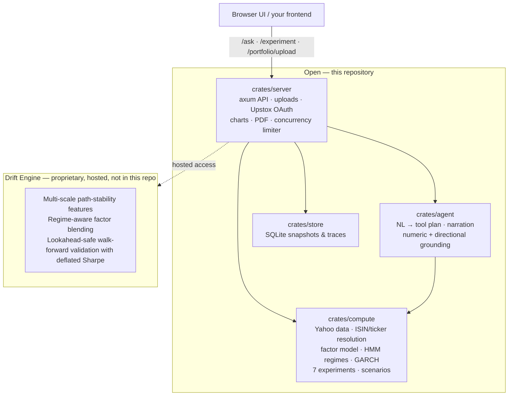

# Drift

**Institutional-grade quantitative risk research for Indian equities — every number comes with its evidence trail.**

[](https://github.com/samvardhan03/Drift/actions/workflows/ci.yml)
[](#license)
[](rust-toolchain.toml)
[](#development)

Drift takes an Indian equity portfolio — typed in, uploaded straight from your broker's holdings export, or imported from Upstox — and answers the questions a risk desk asks: *where is my risk concentrated, what happens if the market falls 12% and crude rises 20%, what would a repeat of IL&FS cost me, and what weights would cut my tail risk?* Every answer is an `EvidenceTrace`: the inputs, data window, fitted model parameters, invariants checked, and outputs — so any number can be traced back to the prices that produced it. Ask in plain English and an AI narrates the result, but only after every figure it quotes has been checked against the trace.

<!-- TODO: demo GIF — local server, ask a question, open "View details" charts, download the PDF. -->
<!-- TODO: screenshot of a generated PDF report page. -->

---

## 60-second quickstart

No paid keys needed. Market data comes from Yahoo Finance.

```bash
git clone https://github.com/samvardhan03/Drift.git && cd Drift
cargo run -p server --release
# → http://localhost:8080
```

Or with Docker:

```bash
docker build -t drift . && docker run -p 8080:8080 drift
```

Without `GEMINI_API_KEY` the server runs in **compute-only mode**: the UI, `/experiment`, scenarios, broker uploads and PDF reports all work; `/ask` (natural language) returns `503`. Add a free key from [Google AI Studio](https://aistudio.google.com/) to turn on narration:

```bash
export GEMINI_API_KEY=...   # in your shell — never commit it
cargo run -p server --release
```

`GET /health` reports which integrations are configured (`gemini`, `upstox`) and current request load.

---

## Why Drift

| | |
|---|---|
| **Evidence on every number** | Each result is an `EvidenceTrace` with its inputs, `data_window`, `data_as_of`, `data_quality`, fitted `model_params`, checked `invariants` and `outputs`. Traces are stored and retrievable at `/execution-trace/:id`. |
| **Grounded narration** | The AI may only narrate values present in the trace. A verbatim-number check rejects any figure that isn't there, directional and recommendation checks catch answers that describe a number backwards or single out a holding the trace doesn't, and failed narrations are retried. |
| **Regime-aware risk** | A 3-state Gaussian HMM labels market regimes and risk is recomputed with regime-conditional factor covariance, so "what if we're in a crisis regime" is a first-class question. |
| **India-first** | NSE/BSE tickers, ISIN resolution, holdings exports from 9 Indian brokers, lakh/crore INR formatting, and Indian stress scenarios (IL&FS, COVID crash, taper tantrum). |
| **Rust** | One static binary, async axum server, compute on a blocking pool, request concurrency limiter, market-data cache warmed at startup. |

---

## What's in the open core

### Experiments (`POST /experiment`, or picked automatically by `/ask`)

| Experiment | Question it answers |
|---|---|
| `FactorShock` | What happens to my portfolio if MARKET / USDINR / BRENT / GOLD_USD / RATES_PROXY move by X%? |
| `RiskDecomposition` | Which factors and which holdings drive my volatility? |
| `CvarRebalance` | What weights minimise tail loss (CVaR, Rockafellar–Uryasev LP) under my position caps? |
| `PortfolioPerformance` | Realised returns, volatility, drawdown — plus a GARCH(1,1) volatility forecast. |
| `RiskDrift` | What changed in my risk since the last snapshot, and why? |
| `ReverseStress` | What is the smallest shock that breaches my loss limit? |
| `PolicyCheck` | Does this portfolio violate my risk policy (position, volatility, factor-concentration, turnover and scenario-loss limits)? |

Any experiment can carry an optional `policy` and gets a passive policy check attached to its trace.

### Getting a portfolio in

- **Upload** (`POST /portfolio/upload`, CSV or XLSX): native holdings exports from Zerodha, Upstox, Groww, Angel One, HDFC Securities, ICICI Direct, 5Paisa, Motilal Oswal and Kotak Securities are recognised by their column headers.
- **ISIN resolution**: exports that identify holdings by ISIN are resolved to NSE/BSE symbols; ETFs, mutual funds, bonds, SME and delisted instruments are classified and skipped with an explanation rather than silently dropped.
- **Upstox OAuth import** (`/auth/upstox/*`): optional, needs your own Upstox developer app.

### Outputs

- JSON `EvidenceTrace` for every experiment
- Chart-ready visualisation data (daily portfolio value history with regime labels, factor and holding contributions, shock impacts)
- PDF reports at `GET /report/:id`
- An embedded single-page UI at `/`

---

## Architecture



```
POST /experiment   validate → fetch & align NSE prices (cached) → fit factor model + HMM regime
                   → run experiment → EvidenceTrace (stored in SQLite, renderable as PDF)

POST /ask          NL → tool plan (Gemini function calling) → same compute path, one or more tools
                   → narration → numeric + directional grounding (retry on failure) → answer + charts
```

More in [docs/architecture.md](docs/architecture.md).

---

## Open core vs. Drift Engine

| | Open (this repo) | Drift Engine (hosted) |
|---|:-:|:-:|
| Factor risk model, HMM regimes, GARCH forecast | ✓ | ✓ |
| All 7 portfolio experiments + stress scenarios | ✓ | ✓ |
| Broker uploads, ISIN resolution, Upstox import | ✓ | ✓ |
| Grounded AI narration, charts, PDF reports | ✓ | ✓ |
| Self-hostable, MIT-licensed | ✓ | — |
| Multi-scale path-stability features | — | ✓ |
| Regime-aware factor blending | — | ✓ |
| Lookahead-safe walk-forward validation with deflated Sharpe | — | ✓ |

**[Request Drift Engine access →](https://github.com/samvardhan03/Drift/discussions)** <!-- TODO: replace with waitlist link -->

---

## Examples

```bash
# What if the market falls 12% and Brent rises 20%?
curl -s localhost:8080/experiment -H 'content-type: application/json' -d '{
  "portfolio": {"total_value_inr": 1000000, "holdings": [
    {"ticker": "RELIANCE.NS", "weight": 0.3}, {"ticker": "TCS.NS", "weight": 0.3},
    {"ticker": "HDFCBANK.NS", "weight": 0.2}, {"ticker": "INFY.NS", "weight": 0.2}]},
  "experiment": {"type": "FactorShock", "shocks_pct": {"MARKET": -12.0, "BRENT": 20.0}}
}'

# Upload a Zerodha holdings export
curl -s localhost:8080/portfolio/upload -F file=@crates/server/tests/fixtures/zerodha_holdings.xlsx

# Ask in plain English (needs GEMINI_API_KEY)
curl -s localhost:8080/ask -H 'content-type: application/json' -d '{
  "portfolio": {"total_value_inr": 1000000, "holdings": [
    {"ticker": "RELIANCE.NS", "weight": 0.5}, {"ticker": "HDFCBANK.NS", "weight": 0.5}]},
  "message": "Where is my risk concentrated, and how would an IL&FS-style shock hit me?"
}'
```

Command-line runner (no server): `cargo run -p compute --bin experiment -- crates/compute/examples/risk_decomposition_nifty10.json`. Full endpoint reference: [docs/api-reference.md](docs/api-reference.md) · Postman: [drift.postman_collection.json](drift.postman_collection.json).

### Historical scenarios (`GET /scenarios`)

| Scenario | Period |
|---|---|
| COVID Crash | Mar 2020 |
| IL&FS Contagion | Sep–Oct 2018 |
| Taper Tantrum | May–Aug 2013 |

---

## Configuration

| Variable | Default | Purpose |
|---|---|---|
| `GEMINI_API_KEY` | — | Enables `/ask` and narration. Optional. |
| `SNAPSHOT_DB_PATH` | `./data/snapshots.db` | SQLite store for snapshots and traces |
| `PORT` | `8080` | Listen port |
| `UPSTOX_API_KEY`, `UPSTOX_API_SECRET` | — | Optional Upstox OAuth import |
| `UPSTOX_REDIRECT_URI` | `http://localhost:8080/auth/upstox/callback` | Must match your Upstox app |
| `RUST_LOG` | `info` | Log filter |

Deployment recipes (Docker, Cloud Run, Fly.io): [docs/deploy.md](docs/deploy.md).

---

## Development

```bash
cargo fmt --all -- --check
cargo clippy --workspace --all-targets -- -D warnings
cargo test --workspace      # 325 passing, 4 ignored (need live network)
```

Tests use synthetic data and a mocked Gemini client, so they run offline. See [CONTRIBUTING.md](CONTRIBUTING.md) and the [FAQ](docs/faq.md).

## Citation

```bibtex
@software{drift,
  title  = {Drift: open-core quantitative risk research for Indian equities},
  author = {Drift contributors},
  year   = {2026},
  url    = {https://github.com/samvardhan03/Drift}
}
```

## License

The Rust workspace originates from [elli0t-yash/drift-risk-copilot](https://github.com/elli0t-yash/drift-risk-copilot) and remains under its [MIT license](LICENSE). New contributions to this repository are dual-licensed **MIT OR Apache-2.0** ([LICENSE-APACHE](LICENSE-APACHE)). The Drift Engine is proprietary and not included — see [NOTICE](NOTICE).

## Disclaimer

Drift is a research tool. It is not investment advice, and its maintainers are not SEBI-registered investment advisers or research analysts. Outputs are informational; you are responsible for your own investment decisions. Past performance does not guarantee future results.
