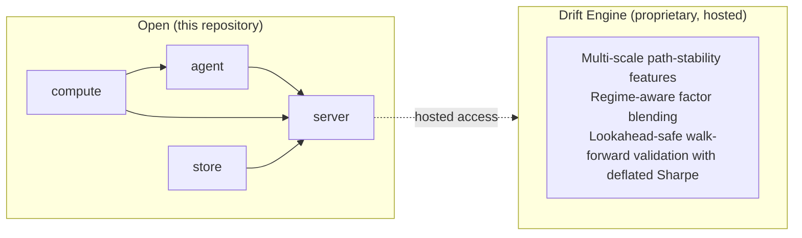

# Architecture

## Crates

| Crate | Responsibility | Key modules |
|---|---|---|
| `compute` | Market data, models and experiments. Pure Rust, no AI. | `data` (Yahoo fetch, cache, NSE calendar alignment) · `ticker_map`, `isin` (symbol/ISIN resolution) · `model` (OLS factor fits, Ledoit–Wolf covariance, regime-conditional covariance) · `regime` (3-state Gaussian HMM) · `garch` (GARCH(1,1) forecast) · `experiments`, `cvar`, `drift`, `reverse_stress`, `policy`, `performance` · `scenarios` · `portfolio_history` · `trace` (`EvidenceTrace`) · `dispatch` (single entry point) |
| `agent` | Natural language in, grounded narration out. | `orchestrator` (NL → tool plan) · `parse`, `schema` (function declarations) · `narrate` · `grounding` (numeric check + retry) · `direction` (directional/recommendation checks) · `suggest` (follow-up question) · `pipeline` · `gemini` (HTTP client with retries) |
| `server` | HTTP surface. | `routes` · `upload` (9 broker formats, CSV/XLSX) · `upstox` (OAuth import) · `visualization` (chart data) · `pdf` · `backend` (`RealBackend`, `NoAiBackend`) · `error`, `validate`, `logging` · embedded UI in `static/index.html` |
| `store` | Persistence. | SQLite (bundled `rusqlite`) snapshots and agent execution traces |

## Request lifecycle

```
POST /experiment
  validate portfolio (≥2 holdings, weights)
  └─ compute::dispatch::run_experiment
       ├─ resolve tickers → fetch / load cached prices → align to NSE calendar
       ├─ fit factor model + HMM regime (+ GARCH for PortfolioPerformance)
       ├─ run the experiment, attach passive policy check if a policy was given
       └─ EvidenceTrace ──► stored in SQLite ──► JSON response
                                            └─► GET /report/:id renders PDF

POST /ask   (GEMINI_API_KEY required)
  agent::orchestrator   NL + conversation history → plan of 1..n tools
  compute::dispatch     run each planned experiment (same path as above)
  agent::narrate        narrate trace values only
  agent::grounding      every quoted number must exist in a trace → retry if not
  agent::direction      flag backwards descriptions / ungrounded recommendations
  agent::suggest        one follow-up question
  server::visualization chart data (portfolio history first)
  └─ answer + traces + charts + execution trace (GET /execution-trace/:id)
```

## Operational behaviour

- **Compute-only mode:** without `GEMINI_API_KEY`, `NoAiBackend` serves every compute route; `/ask` returns `503`.
- **Concurrency:** `/ask` requests go through a semaphore with a queue timeout; `/health` reports `active_requests` and `capacity`.
- **Cache warmup:** shortly after startup, common NSE large caps and the factor series are fetched into `data/cache/`; failures are logged, never fatal.
- **Errors:** every error is JSON `{ "error", "code" }`, including framework-level rejections.

## Evidence trace

An `EvidenceTrace` contains `inputs`, `data_window`, `data_as_of`, `data_quality`, `model_params`, `outputs`, `invariants`, provenance for scenarios, parent trace ids for multi-step answers, and an optional `policy_result`. It is the contract between `compute`, `agent`, the PDF renderer and any client.

## Open core and Drift Engine



The Drift Engine is not included in this repository and no part of its implementation is described here.
